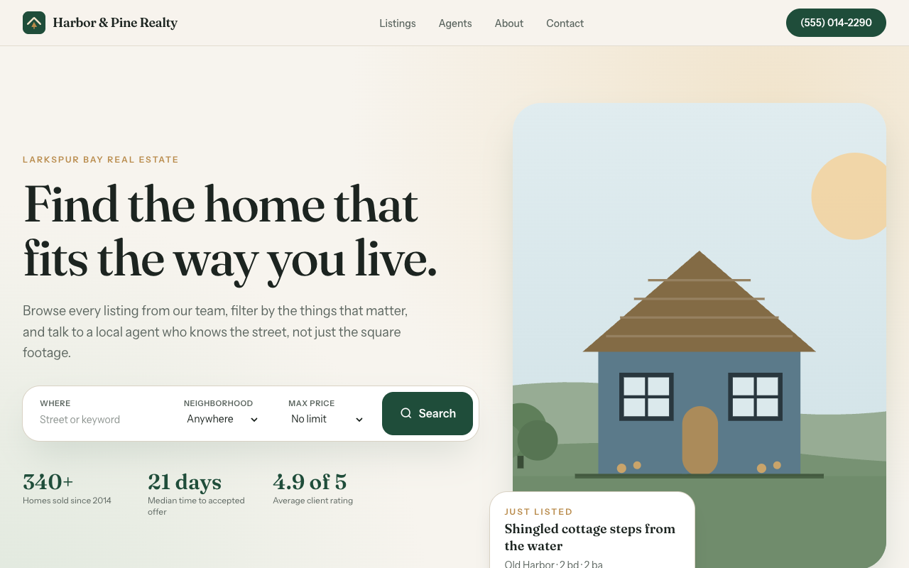

# Real Estate Website Template

A polished real estate website for an agency or independent agent: searchable listings with filters, a page for every property, agent profiles and inquiry forms. It builds to plain static files, so it needs no server.



[](https://console.cloudzyro.com/new?repo=https://github.com/Cloudzyro/template-real-estate)

## What's included

- Home page with a hero search (location, neighborhood, max price), featured homes, neighborhood cards, the team and a home valuation call to action
- Listings page with instant filters for price range, beds, baths, neighborhood, home type and keyword, plus sorting. Filters are kept in the address, so filtered results can be shared
- A detail page per property, generated from one data file: gallery with five views, key facts, description and highlights, a map preview that opens the address in OpenStreetMap, the listing agent's card, an inquiry form and similar homes
- Agents page with bios, specialties, direct call and email buttons and each agent's current listings
- About and Contact pages, and a friendly 404 page
- Illustrated SVG placeholders for every home and agent (no stock photos to license)
- SEO: a title and description per page, Open Graph image, canonical links, `sitemap.xml`, `robots.txt` and a favicon
- Responsive down to 360px, keyboard friendly, visible focus styles, and reduced motion respected
- No tracking and no third-party scripts

## Run it locally

You need Node.js 20 or newer and pnpm.

```bash
pnpm install
pnpm dev      # http://localhost:3000
pnpm build    # static site in ./out
pnpm start    # serve ./out locally
```

## Make it yours

- **Listings:** `data/listings.ts`. Each entry has its address, neighborhood, price, beds, baths, size, description, highlights and the `agentId` of the agent who lists it. Its `slug` becomes the page address (`/listings/<slug>/`).
- **Agents:** `data/agents.ts`.
- **Agency details and page text:** `data/site.ts` holds the name, contact details, menu, hero copy, stats, neighborhoods, About and Contact text. Set `url` to your domain so the sitemap and social cards use it.
- **Forms:** set `NEXT_PUBLIC_FORM_ENDPOINT` to any service that accepts a form POST (Formspree, Basin, a Supabase edge function and similar). Copy `.env.example` to `.env.local` for local work, and add the variable in your host's settings for the live site. Without it, the forms tell visitors nothing was sent and offer a prepared email instead. Inquiries from a property page are addressed to that listing's agent.
- **Photos:** the art comes from `components/PropertyArt.tsx`. To use real photos, add them to `public/` and render `` tags in `components/ListingGallery.tsx` and `components/ListingCard.tsx` instead of `<PropertyArt>`.
- **Colors and fonts:** colors are in the `@theme` block at the top of `app/globals.css`. Fonts (Fraunces and Instrument Sans) are loaded in `app/layout.tsx` with `next/font`.
- **Social image:** replace `public/og.png` (1200 x 630).

## Deploy

Click the button above to deploy a copy, or push your own copy to GitHub and connect it in the Cloudzyro console. The build command is `pnpm build` and the output folder is `out`. Remember to set `NEXT_PUBLIC_FORM_ENDPOINT` before building if you want the forms to send.

## Stack

- [Next.js](https://nextjs.org) 16 with static export (`output: "export"`)
- React 19 and TypeScript
- [Tailwind CSS](https://tailwindcss.com) 4

## License

MIT. See [LICENSE](./LICENSE).
